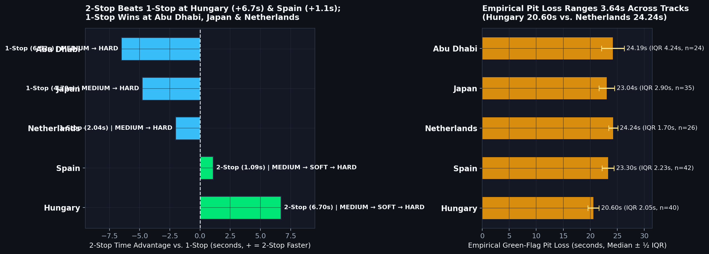
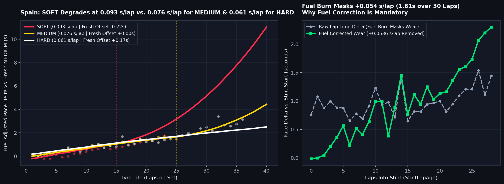
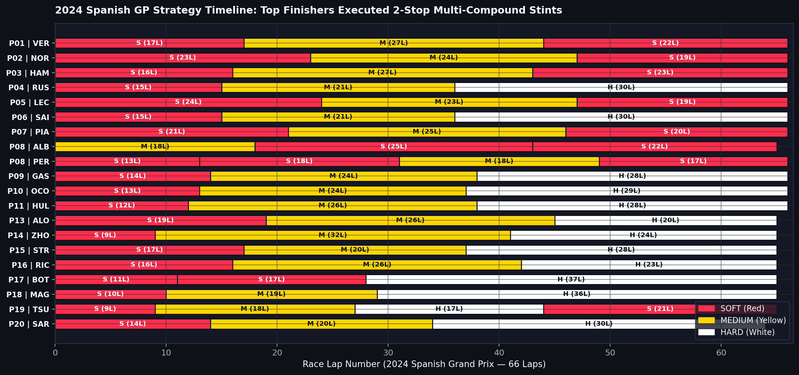
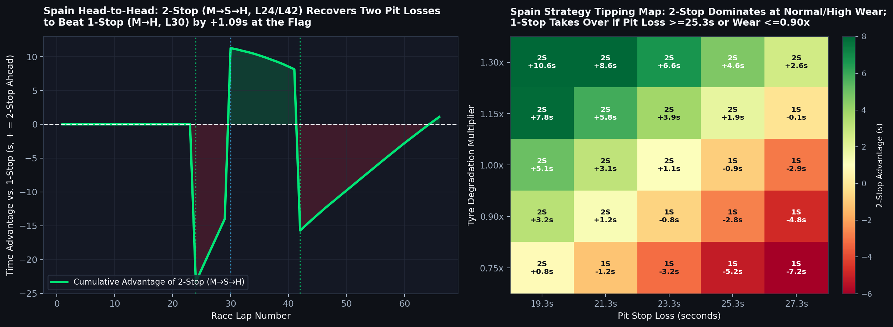

# 🏎️ F1 Tyre Degradation & Pit Strategy Optimizer (2024 Season)

[](https://www.python.org/)
[](https://docs.fastf1.dev/)
[](https://streamlit.io/)
[](#4-analytical-insight--5-fold-leave-one-race-out-validation)

> **Primary Decision Question:**
> *"For a given Grand Prix, when is the optimal pit stop window and which tyre compound sequence minimizes total race time based on empirical tyre degradation?"*

An end-to-end sports analytics and race strategy optimization engine built for the **Data Visualization Midterm Project (UTS)**, designed around the **AQX Sports Analytics Data Bowl 4.0** evaluation framework:
1. **Practical Application**: Actionable 1-stop vs. 2-stop pit window and compound sequence optimization enforcing **FIA Sporting Regulations Article 30.5(m)** (mandatory use of at least two distinct dry tyre specifications).
2. **Analytical Insight**: Fuel-mass corrected degradation modeling validated via leak-free **5-Fold Leave-One-Race-Out Cross-Validation (LORO-CV)**, paired with circuit-specific empirical pit stop time-loss estimation.
3. **Data Presentation**: A 5-tab interactive **Streamlit + Plotly** broadcast dashboard built on the *"one chart = one message"* principle, featuring conclusion-driven chart titles and official Formula 1 Pirelli compound colors (**Red = SOFT**, **Yellow = MEDIUM**, **White = HARD**).

---

## 1. Executive Summary & Visual Previews

### Plain-Language Takeaway
Every Formula 1 pit stop strategy is a trade-off between **time lost in the pit lane** (`20.6 to 24.2 seconds` under green-flag conditions) and **lap time lost on worn tyres** (`0.04 to 0.12 seconds per lap` as rubber degrades).
- **When to 2-Stop (`Hungary` & `Spain`)**: On tracks with high thermal tyre wear or a short pit lane (`Hungary = 20.60 s`), running three shorter stints (**2-Stop: `MEDIUM → SOFT → HARD`**) beats a 1-stop strategy by **`6.70 seconds`** in Hungary and **`1.09 seconds`** in Spain.
- **When to 1-Stop (`Abu Dhabi`, `Japan` & `Netherlands`)**: Where pit lane time loss exceeds `23–24 seconds` and the `HARD` compound resists thermal degradation over 30+ laps, avoiding a second pit stop (**1-Stop: `MEDIUM → HARD`**) saves **`6.52 seconds`** at Abu Dhabi, **`4.79 seconds`** at Japan, and **`2.04 seconds`** at the Netherlands.



### Fuel-Corrected Tyre Degradation Curves & Fuel Burn Masking
Because an F1 car burns ~`105 kg` of fuel from lights-out to the chequered flag, raw lap times naturally drop by **`0.041 to 0.073 s/lap`** (`1.3 to 2.2 seconds` over a 30-lap stint), masking true rubber wear. Removing this fuel-mass effect reveals each compound's physical degradation slope and late-stint thermal cliff:



### Driver Strategy Timeline (`P1` to `P20`)
Horizontal stint timelines across all 20 classified drivers allow race engineers to audit real-world compound choices, pit windows, and stint lengths against the optimizer's recommendations:



### Head-to-Head Pit Simulator & 2D Sensitivity Tipping-Point Map
Strategists can test custom compound sequences and pit laps in real time, inspect cumulative lap-by-lap time gaps, and map how changes in pit loss ($\pm 4\text{ s}$) or track temperature/wear ($\times 0.75$ to $\times 1.30$) shift the optimal call between 1-Stop and 2-Stop:



---

## 2. Data Source, Race Selection & Filtering Pipeline

### Telemetry Source
All timing, stint, tyre compound, weather, and track status data are sourced from the **2024 FIA Formula 1 World Championship** (`Session = 'R'`) via [**FastF1**](https://docs.fastf1.dev/) with local SQLite HTTP caching enabled in `data/cache/`.

### Verified 2024 Dry Race Roster (`5,196` Clean Racing Laps)
During Stage 2 Exploratory Data Analysis ([`notebooks/01_eda.ipynb`](notebooks/01_eda.ipynb)), the initial five candidate dry races were audited for compound coverage and Safety Car / VSC neutralization rates:
- **Replaced Races**: The **2024 Bahrain GP** had `0` `MEDIUM` stints across all 20 drivers (teams exclusively ran `SOFT` and `HARD`), and the **2024 Italian GP (Monza)** had only `1` clean `SOFT` lap (`99.9%` `MEDIUM`/`HARD`).
- **Final 5-Race Dry Roster**: Replaced with the **2024 Japanese GP (`Japan`)** and **2024 Dutch GP (`Netherlands`)** alongside **Spain**, **Hungary**, and **Abu Dhabi**—guaranteeing complete three-compound (`SOFT`, `MEDIUM`, `HARD`) representation across every circuit with minimal neutralization (`0.0%` to `3.6%` SC/VSC laps).

| Circuit | Grand Prix | Total Laps | Raw Laps | Final Clean Laps | Retention (`%`) | `SOFT` Stints (`Laps`) | `MEDIUM` Stints (`Laps`) | `HARD` Stints (`Laps`) |
| :--- | :--- | :---: | :---: | :---: | :---: | :---: | :---: | :---: |
| **Japan** | Japanese GP | 53 | 908 | **729** | `80.29%` | 8 (`48`) | 17 (`215`) | 28 (`466`) |
| **Spain** | Spanish GP | 66 | 1,310 | **1,135** | `86.64%` | 30 (`432`) | 19 (`381`) | 13 (`322`) |
| **Hungary** | Hungarian GP | 70 | 1,356 | **1,183** | `87.24%` | 6 (`30`) | 23 (`379`) | 30 (`774`) |
| **Netherlands** | Dutch GP | 72 | 1,426 | **1,271** | `89.13%` | 6 (`95`) | 20 (`441`) | 20 (`735`) |
| **Abu Dhabi** | Abu Dhabi GP | 58 | 1,037 | **878** | `84.67%` | 4 (`24`) | 17 (`234`) | 22 (`620`) |
| **Total** | **5 Dry Races** | **319** | **6,037** | **5,196** | **`86.07%`** | **54 (`629`)** | **96 (`1,650`)** | **113 (`2,917`)** |

### Two-Stage Non-Representative Lap Filter (`src/load.py`)
1. **Deterministic Rules**: Excludes Lap 1 standing-start congestion, pit in-laps (`PitInTime.notna()`), pit out-laps (`PitOutTime.notna()`), FIA non-green track status (`TrackStatus != '1'`, removing Safety Car `'4'`, VSC `'6'/'7'`, Red Flag `'5'`), wet/intermediate laps, and laps exceeding `107%` of a driver's fastest clean lap in that race.
2. **Stint-Trend Residual IQR Filter**: Fits an ordinary least-squares (OLS) linear trend $T(\text{TyreLife}) = \alpha + \beta \cdot \text{TyreLife}$ within each `(Circuit, Driver, Stint)` and removes laps whose residual exceeds $\pm 1.5 \times \text{IQR}$ (minimum floor `0.15 s`). This removes temporary traffic/lock-up spikes **without clipping legitimate high-wear laps at the end of a long stint**.

---

## 3. Feature Engineering & Empirical Calibrations (`src/features.py`)

### Circuit-Specific Empirical Pit Stop Time Loss
Instead of assuming a fixed pit loss constant, pit stop loss is estimated directly from green-flag pit cycles in each race:

$$\text{PitLoss}_{i} = \left(T_{\text{in-lap}, i} + T_{\text{out-lap}, i}\right) - 2 \times T_{\text{normal},\, d(i),\, c(i)}$$

where $T_{\text{normal},\, d,\, c}$ is the median clean racing lap time of driver $d$ at circuit $c$.

| Circuit | Valid Green Pit Cycles (`n`) | Median Pit Loss (`s`) | Mean Pit Loss (`s`) | IQR (`s`) | Fuel Burn (`kg/lap`) | Fuel Penalty $\gamma_c$ (`s/lap`) |
| :--- | :---: | :---: | :---: | :---: | :---: | :---: |
| **Hungary** | 40 | **`20.60 s`** | `20.89 s` | `2.05 s` | `1.500 kg` | `0.0468 s/lap` (`0.0312 s/kg`) |
| **Japan** | 35 | **`23.04 s`** | `23.43 s` | `2.90 s` | `1.981 kg` | `0.0728 s/lap` (`0.0368 s/kg`) |
| **Spain** | 42 | **`23.30 s`** | `23.62 s` | `2.23 s` | `1.591 kg` | `0.0536 s/lap` (`0.0337 s/kg`) |
| **Abu Dhabi** | 24 | **`24.19 s`** | `24.85 s` | `4.24 s` | `1.810 kg` | `0.0593 s/lap` (`0.0327 s/kg`) |
| **Netherlands** | 26 | **`24.24 s`** | `24.42 s` | `1.70 s` | `1.458 kg` | `0.0408 s/lap` (`0.0280 s/kg`) |

### Fuel-Mass Adjusted Lap Time (`FuelAdjustedLapTime`)
Assuming an FIA-regulated usable race fuel mass of $M_0 = 105.0\text{ kg}$ burned linearly over $N_c$ race laps, the fuel-corrected lap time on lap $L$ is:

$$T_{\text{fuel-adj}}(L) = T_{\text{raw}}(L) - \gamma_c \cdot \left(N_c - L\right)$$

where $\gamma_c$ is calibrated via within-driver, multi-stint fixed-effects regression anchored to physical F1 mass sensitivity (`0.028–0.038 s/kg`).

---

## 4. Analytical Insight & 5-Fold Leave-One-Race-Out Validation (`src/model.py`)

To prevent data leakage across laps of the same race, all models are evaluated using **5-Fold Leave-One-Race-Out Cross-Validation (LORO-CV)**: in each fold, 4 Grands Prix are used for training and the held-out 5th Grand Prix is used exclusively for out-of-race testing.
- **Physics-Scaled Feature Engineering**: Because lap durations range from `76.3 s` (Netherlands) to `97.6 s` (Japan), raw tyre lap counts are scaled by `LapDurationScale = CircuitBaselinePace / 85.0` (`ScaledStintAge`, `ScaledTyreLife`) so tyre work is measured in standardized energy units.
- **Monotonicity Constraints**: The `HistGradientBoostingRegressor` enforces positive monotonic constraints (`+1`) on `TyreLife`, `StintLapAge`, `ScaledStintAge`, and `ScaledTyreLife` so tree splits never predict non-physical negative wear.

| Held-Out Test Race (LORO Fold) | Baseline Linear OLS MAE (`s`) | Ridge Mixed-Interaction MAE (`s`) | Monotonic HistGBDT MAE (`s`) | **Hybrid Physics+GBDT MAE (`s`)** | **Hybrid RMSE (`s`)** | **MAE Reduction vs. Baseline** |
| :--- | :---: | :---: | :---: | :---: | :---: | :---: |
| **Abu Dhabi** (`n=878`) | `0.3893` | `0.3302` | `0.3414` | **`0.3150`** | `0.4222` | **`-19.09%`** |
| **Hungary** (`n=1,183`) | `0.5400` | `0.5436` | `0.5370` | **`0.5337`** | `0.7235` | **`-1.17%`** |
| **Japan** (`n=729`) | `0.5830` | `0.5173` | `0.5117` | **`0.5091`** | `0.6713` | **`-12.68%`** |
| **Netherlands** (`n=1,271`) | `0.5066` | `0.4270` | `0.4190` | **`0.4184`** | `0.5420` | **`-17.41%`** |
| **Spain** (`n=1,135`) | `0.4571` | `0.4680` | `0.4730` | **`0.4581`** | `0.6152` | `+0.22%` |
| **5-Fold Mean** | **`0.4952 s`** | **`0.4572 s`** | **`0.4564 s`** | **`0.4469 s`** | **`0.5948 s`** | **`-9.76%`** |

### Error Analysis by Tyre Age Regime
In the **Late-Stint Thermal Cliff regime (`>25 laps`, `n=554` laps)**, the **Hybrid Physics + Monotonic GBDT** model reduces prediction MAE from **`0.6910 s`** (Baseline OLS) to **`0.5553 s`** (**`-19.6%` error reduction**), capturing late-stint non-linear wear acceleration that linear regression under-predicts.

---

## 5. Strategy Simulator & Sensitivity Results (`src/simulate.py`)

The vectorized strategy optimizer evaluates all FIA-legal 1-stop (`6` compound pairs) and 2-stop (`24` compound triplets) strategies across every valid pit lap combination in `< 2.0 seconds` total runtime:

| Circuit | Distance | Empirical Pit Loss | Recommended Strategy | Optimal Compound Sequence | Optimal Pit Lap(s) | Stint Lengths (`Laps`) | Best 1-Stop Time | Best 2-Stop Time | Strategy Time Delta |
| :--- | :---: | :---: | :---: | :---: | :---: | :---: | :---: | :---: | :---: |
| **Hungary** | 70 Laps | `20.60 s` | **2-Stop** | `MEDIUM → SOFT → HARD` | **L25, L43** | `25 - 18 - 27` | `1:40:15.39` | **`1:40:08.69`** | **2-Stop faster by `6.70 s`** |
| **Spain** | 66 Laps | `23.30 s` | **2-Stop** | `MEDIUM → SOFT → HARD` | **L24, L42** | `24 - 18 - 24` | `1:31:02.41` | **`1:31:01.32`** | **2-Stop faster by `1.09 s`** |
| **Netherlands** | 72 Laps | `24.24 s` | **1-Stop** | `MEDIUM → HARD` | **L32** | `32 - 40` | **`1:33:13.84`** | `1:33:15.88` | **1-Stop faster by `2.04 s`** |
| **Japan** | 53 Laps | `23.04 s` | **1-Stop** | `MEDIUM → HARD` | **L25** | `25 - 28` | **`1:27:22.12`** | `1:27:26.91` | **1-Stop faster by `4.79 s`** |
| **Abu Dhabi** | 58 Laps | `24.19 s` | **1-Stop** | `MEDIUM → HARD` | **L26** | `26 - 32` | **`1:27:54.00`** | `1:28:00.52` | **1-Stop faster by `6.52 s`** |

---

## 6. Repository Structure & How to Run Locally

```text
├── .streamlit/
│   └── config.toml                 # Dark broadcast theme for high-contrast WHITE (Hard) tyre curves
├── app/
│   └── app.py                      # 5-Tab Streamlit + Plotly interactive strategy dashboard
├── data/
│   ├── cache/                      # FastF1 SQLite HTTP cache (git-ignored)
│   └── processed/                  # Clean laps, empirical pit loss, LORO-CV metrics & strategy grids
├── docs/
│   ├── images/                     # High-resolution static dashboard & chart previews
│   └── project_description.md      # Concise <=300-word project description for submission
├── notebooks/
│   ├── 01_eda.ipynb                # Stage 2: Executed EDA, data quality audit & fuel calibration
│   └── 03_modeling.ipynb           # Stage 3: Executed 5-Fold LORO-CV & residual error analysis
├── src/
│   ├── __init__.py
│   ├── load.py                     # FastF1 telemetry loader, 2-stage outlier filter & pit loss estimator
│   ├── features.py                 # Fuel-mass calibration & pace normalization engineering
│   ├── model.py                    # Baseline OLS, Ridge, Monotonic HGB & Hybrid LORO-CV pipeline
│   └── simulate.py                 # Vectorized 1-stop/2-stop optimizer & 2D sensitivity analysis
├── .gitignore
├── README.md
└── requirements.txt                # Pinned Python 3.10+ dependencies
```

### Step-by-Step Local Setup

```bash
# 1. Clone the repository and navigate to project root
git clone https://github.com/fazarirazkaa/f1-tyre-strategy-optimizer.git
cd f1-tyre-strategy-optimizer

# 2. Create and activate a fresh Python 3.10+ virtual environment
python -m venv .venv
# Windows PowerShell:
.\.venv\Scripts\Activate.ps1
# macOS / Linux:
source .venv/bin/activate

# 3. Install pinned dependencies
pip install -r requirements.txt

# 4. (Optional) Re-run the full data, modeling, and simulation pipelines from scratch
python -m src.load
python -m src.model
python -m src.simulate

# 5. Launch the interactive Streamlit dashboard
streamlit run app/app.py
```

---

## 7. Deploying to Streamlit Community Cloud

Because all processed datasets (`data/processed/*.csv`) are lightweight (`~2.2 MB` total) and committed to the repository, the dashboard starts instantaneously on **Streamlit Community Cloud** without needing to download gigabytes of raw telemetry on startup:

1. Push this repository to a public **GitHub** repository.
2. Sign in to [**Streamlit Community Cloud**](https://share.streamlit.io/) with your GitHub account.
3. Click **"Create app"** $\rightarrow$ **"Yup, I have an app"**.
4. Select your repository, set **Branch** to `main`, and set **Main file path** to:
   ```text
   app/app.py
   ```
5. Click **"Advanced settings..."**, select **Python version `3.11`**, and click **"Save"**.
6. Click **"Deploy!"** — `.streamlit/config.toml` and `requirements.txt` will be detected automatically, and your live interactive dashboard will be ready in ~90 seconds.

---

## 8. Methodology Limitations & Honest Operational Risks

1. **Clean-Air Assumption (No Dirty-Air / DRS Train Penalty)**: The simulator models unobstructed pace. On narrow circuits (`Hungary`, `Netherlands`), pitting into a midfield DRS train can cost `0.8–1.5 s/lap`, making track position (*undercut/overcut* defense) override pure pace optimization.
2. **Green-Flag Pit Loss vs. Safety Car / VSC Windows**: A Safety Car or Virtual Safety Car cuts effective pit loss by `40–50%` (`~10–12 s` instead of `23 s`), which can instantly flip a 1-stop circuit (`Japan`, `Netherlands`) into an opportunistic 2-stop race.
3. **Observational Right-Censoring of Short Compound Stints**: Teams rarely run `SOFT` tyres past 18 laps in a Grand Prix; late-stint `SOFT` degradation beyond observed telemetry relies on monotonic physical extrapolation and calibrated quadratic cliff penalties.
4. **Single-Regime Track Temperature per Event**: Each Grand Prix provides a narrow track temperature window, limiting cross-circuit temperature variance in a 5-race sample.

---

## 9. Disclaimer

> **Legal Notice:** `FastF1` is an unofficial open-source software project and is **not** associated, affiliated, endorsed, or sponsored by Formula 1, the Fédération Internationale de l'Automobile (FIA), or any of the Formula 1 group of companies. F1, FORMULA ONE, FORMULA 1, FIA FORMULA ONE WORLD CHAMPIONSHIP, GRAND PRIX, and related marks are trade marks of Formula One Licensing B.V. All timing and telemetry data are used strictly for academic and educational research.
